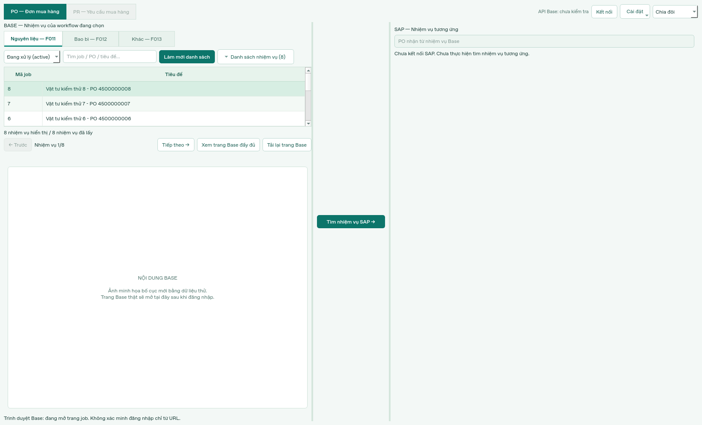

# Boston Pharma — Đối chiếu PO / PR — Base & SAP

App Python chạy trên Windows, dùng Qt WebEngine để xem trang Base trong trình duyệt nhúng. Logo Boston Pharma chỉ dùng làm icon cạnh tiêu đề trên thanh cửa sổ, không có banner logo/tiêu đề lớn trong nội dung. File chạy chính: `base_sap_workspace.py`. Không cần các file Python phiên bản cũ hoặc các workbook Excel trong repository để chạy app này.

## Cài đặt và chạy

Cài Python 3.12 trở lên, bản 64-bit. Mở CMD trong thư mục `base-sap-workspace` rồi chạy:

```bat
python -m pip install -r requirements.txt
python base_sap_workspace.py
```

Hoặc sau khi cài thư viện, mở `run_windows.bat`. Nếu chỉ muốn dùng một file Python, cài `PySide6 requests pywin32` rồi chạy `base_sap_workspace.py`.

## Cách sử dụng

1. Bấm **Kết nối**, nhập token Base Workflow v2 và bấm **Lưu token**. App lấy danh sách của workflow đang chọn. Token chỉ giữ trong RAM đến khi đóng app, không được ghi vào mã nguồn hoặc file cấu hình.
2. Vào **Kết nối → Mở đăng nhập Base**, đăng nhập trực tiếp trên website trong khung trái. Token API và phiên đăng nhập trình duyệt là hai phần độc lập.
3. Chọn **Nguyên liệu — F011**, **Bao bì — F012**, hoặc **Khác — F013**. Khi đã có token, tab chưa có dữ liệu sẽ tự tải lần đầu; tab đã tải dùng lại danh sách riêng. Các tab luôn bấm được, kể cả lúc API đang tải. Nếu chuyển sang tab chưa tải trong lúc đọc workflow khác, app yêu cầu dừng lượt cũ sau yêu cầu HTTP hiện tại rồi tải tab được chọn cuối cùng. Có thể phải chờ yêu cầu HTTP hiện tại kết thúc; app không gửi đồng thời hàng loạt lượt tải. **Làm mới danh sách** dùng để đọc lại tab đã có dữ liệu.
4. Ba tab workflow được đặt trong khung Base và căn trái. Lọc theo `state` gốc của Base, tìm theo mã job, PO hoặc tiêu đề; ô tìm kiếm thu gọn để **Làm mới danh sách** và **Danh sách nhiệm vụ** nằm cùng hàng. Bảng chỉ có **Mã job** và **Tiêu đề**, hiển thị trọn 3 dòng rồi cuộn để xem tiếp. Tất cả job vẫn được giữ, không giới hạn danh sách còn 3 job. Chọn một dòng hoặc dùng **Trước / Tiếp theo**; có thể thu gọn bảng.
5. Bộ lọc, từ tìm kiếm, nhiệm vụ đã chọn và trạng thái mở/thu gọn danh sách được nhớ riêng theo workflow trong phiên chạy. Dữ liệu được giữ trong RAM riêng theo cặp workflow và trạng thái; đổi qua lại trạng thái đã tải không gọi lại API. Không lọc theo ngày.
6. **Tìm nhiệm vụ SAP →** nhận PO từ tiêu đề job đang mở; nếu có nhiều PO, app cho chọn, nếu không nhận diện được thì cho nhập. App mở ME29N trong SAP GUI, chọn PO và kiểm tra số PO đang hiển thị. Người dùng tự duyệt trên từng hệ thống; app không bấm Release hoặc Save.
7. Có thể kéo thanh chia khung hoặc chọn **Mở rộng Base / Chia đôi / Mở rộng SAP**. **Xem trang Base đầy đủ** thay đổi bố cục hiển thị, không tải lại trang.

**PR đang tạm khóa**, chờ xác định workflow tương ứng. App không gộp trạng thái Base/SAP hoặc tạo trạng thái nghiệp vụ mới.

## SAP GUI trên Windows

Cài thêm `pywin32` nếu bạn dùng lại môi trường Python cũ:

```bat
python -m pip install pywin32
```

- SAP Logon cần có kết nối **PRD800** cấu hình sẵn. App dùng profile đó; không chứa router/password trong mã nguồn.
- Đường dẫn mặc định: `C:\Program Files (x86)\SAP\FrontEnd\SAPgui\saplogon.exe`. Có thể đổi đường dẫn và tên kết nối trong **Cài đặt → Cấu hình SAP GUI…** trước khi kết nối.
- Cần SAP GUI Scripting được cho phép ở máy khách (SAP GUI Options → Accessibility & Scripting → Scripting) và máy chủ. Nếu máy chủ tắt Scripting, liên hệ quản trị SAP; app không tự đổi cấu hình bảo mật.
- Bấm **Mở SAP PRD800**, nhập tài khoản/mật khẩu trực tiếp trên màn hình SAP được nhúng bên phải. App không đọc hoặc lưu mật khẩu.
- Chọn job Base, bấm **Tìm nhiệm vụ SAP →**. Nếu chưa đăng nhập, yêu cầu PO được giữ trong lúc người dùng đăng nhập; phiên sẵn sàng thì tự tiếp tục, không cần bấm tìm lại. App mở ME29N, nhận diện nút Other Purchase Order, điền PO vào hộp chọn chứng từ rồi xác minh số PO. Hộp thoại lạ được giữ nguyên để người dùng xử lý. Nếu không nhận diện được nút, mở hộp chọn PO thủ công rồi bấm tìm lại.
- Ô PO nhận từ Base là yêu cầu tìm kiếm. Dòng **PO đang hiển thị trên SAP** đọc riêng từ ME29N; không suy ra kết quả từ ô yêu cầu. Khi gặp hộp thoại chặn, app hiển thị tên hộp thoại; có thể **Tách cửa sổ SAP** để xử lý rồi tìm lại.
- Đối chiếu và duyệt thủ công trên từng hệ thống. Sau đó bấm **Tiếp theo →** ở Base, rồi **Tìm nhiệm vụ SAP →** lần nữa. Khi đổi job Base, chứng từ SAP cũ vẫn còn; thông báo nhắc rõ chưa có đối chiếu mới. App không suy đoán cả hai bên đã duyệt thành công.
- **Hủy tìm PO** chỉ dừng điều hướng, không hoàn tác thao tác đã gửi. **Tách cửa sổ SAP / Gắn lại SAP** chuyển giữa cửa sổ ngoài và khung phải. Gắn lại dùng cửa sổ đã nhúng trước đó ngay cả khi điều khiển COM bị lỗi; không mở thêm kết nối hay xác nhận PO đã khớp. Nếu cửa sổ đã đóng, app báo cần mở SAP lại. Đóng app sẽ tách SAP ra, không tự đăng xuất SAP.

Phần COM/nhúng cửa sổ được kiểm thử bằng mô phỏng trên Linux, chưa được chạy trực tiếp với SAP GUI 760 trên Windows. Cần kiểm tra trên máy thực tế; nếu nhúng không thành công, có thể dùng cửa sổ SAP bên ngoài. Kết nối Base và SAP độc lập.

## Logo và màu Boston Pharma

Khung app có phối màu xanh ngọc gần theo ảnh nhận diện được cung cấp, chưa phải bảng mã màu chính thức từ brand guideline. Trang Base bên trong giữ giao diện gốc.

Chọn **Cài đặt → Chọn logo Boston Pharma…** để dùng ảnh PNG/JPG/WEBP trên máy. App sao chép nguyên file vào `%LOCALAPPDATA%\BaseF011Viewer\boston_logo`, tự dùng lại lần sau và đặt làm icon cửa sổ. Hoặc đặt `boston_logo.png` cạnh file Python. Logo hình không được đóng gói trong repository; khi chưa chọn ảnh, cửa sổ dùng icon mặc định của hệ điều hành.

## Phạm vi lấy dữ liệu

Endpoint đọc: `POST https://workflow.base.vn/extapi/v1/jobs/get`, gửi `access_token_v2`, `workflow_id`, `page_id` bắt đầu từ 0 và `limit=100`.

**Mặc định chỉ tải `active` trực tiếp từ máy chủ**, không tải toàn bộ lịch sử rồi mới lọc trên máy. Tham số API hoạt động là **`status=active`** (chuỗi trạng thái), dù trường dữ liệu trả về tên là `state`. Đã kiểm tra trực tiếp `status=active` với cả 3 workflow và `status=done`/`status=failed` với F013. Trong phép thử, `state=active` và `status=0` không lọc danh sách.

- Chọn **Đang xử lý**: gửi `status=active`.
- Chọn **Hoàn thành** hoặc **Thất bại**: tải `status=done` hoặc `status=failed` khi cần.
- Chọn **Tất cả**: bỏ tham số `status`; có thể mất thời gian vì tải toàn bộ lịch sử.
- Bộ nhớ tạm tách theo workflow/trạng thái, chỉ tồn tại trong phiên chạy. Kết quả 0 job là hợp lệ, không tự chuyển sang tải toàn bộ lịch sử.
- **Làm mới danh sách** chỉ tải lại trạng thái đang chọn. Tìm kiếm chỉ áp dụng lên dữ liệu trong bộ lọc hiện tại.
- Mỗi phản hồi được kiểm tra cả `workflow_id` và `state`. Nếu máy chủ không áp dụng đúng trạng thái, app báo lỗi thay vì nhận danh sách chưa đúng hoặc chưa đầy đủ.
- Nếu đã chủ động tải **Tất cả**, có thể dùng snapshot đó để lọc các trạng thái chưa có snapshot riêng mà không gọi lại API; thời điểm lấy dữ liệu luôn được hiển thị.

| Tab | Workflow ID |
|---|---:|
| F011 | 3991 |
| F012 | 4156 |
| F013 | 4157 |

App kiểm tra workflow ID, trang phản hồi và tổng số mã job duy nhất trước khi chấp nhận dữ liệu. Các nhiệm vụ chỉ nằm trong phạm vi token có quyền đọc. Nhận diện PO từ tiêu đề là gợi ý văn bản, không xác nhận PO tồn tại trên SAP.

## Lưu ý khi thao tác

Các nút trong trang Base thực hiện thao tác thật. Hoàn tất hoặc lưu nội dung trước khi chuyển job hoặc tải lại trang. **Làm mới danh sách** gọi lại API; **Tải lại trang Base** chỉ tải lại job đang mở. Không có cơ chế tự tải lại định kỳ.

Profile trình duyệt nằm tại `%LOCALAPPDATA%\BaseF011Viewer`. Không chia sẻ thư mục này hoặc đưa cookie/token vào Git. Không mở nhiều bản app dùng cùng profile cùng lúc. Một số nhà cung cấp SSO có thể hạn chế trình duyệt nhúng.

## Kiểm thử

```bat
python test_workspace.py
python test_boston_brand.py
python test_sap.py
```

Trên Linux không có màn hình, đặt `QT_QPA_PLATFORM=offscreen` khi chạy kiểm thử. Bộ kiểm thử dùng Qt widgets/model thực tế, mô phỏng API và trình duyệt để không gửi dữ liệu hoặc thao tác lên hệ thống thật.

Đã đạt 45 kiểm thử giao diện/logic, 3 kiểm thử nhận diện thương hiệu và 18 kiểm thử SAP mô phỏng trên Linux. Các kiểm thử SAP kiểm tra điều hướng ME29N/PO, không thao tác nút Release, dừng trước hộp thoại lạ, chờ đăng nhập, timeout và khôi phục cửa sổ khi tách. Có thêm kiểm thử tham số `status` dạng chữ, phân trang theo tổng đã lọc, kết quả rỗng, từ chối bộ lọc bị máy chủ bỏ qua, bộ nhớ tạm tách trạng thái và chuyển trạng thái khi đang tải. Có kiểm thử chuyển F011/F012/F013 trong lúc tải, chuyển nhanh nhiều tab, giữ dữ liệu đúng workflow, bỏ qua tiến độ từ lượt cũ và đóng app khi có lượt tải chờ. Ba kiểm thử bố cục mới cũng được chạy lại ở mức phóng đại 150% để kiểm tra hàng nút, tab căn trái và 3 dòng hiển thị. Đã kiểm tra riêng bố cục nhúng bằng Chromium ngoại tuyến. Giao diện/đăng nhập Base trên Windows và SAP cần kiểm tra trong môi trường sử dụng thực tế. Không có token, phiên đăng nhập hoặc dữ liệu xuất từ Base/SAP trong thư mục ứng dụng này.

## Minh họa bố cục

Ảnh sử dụng dữ liệu thử và khung trình duyệt mô phỏng, không phải phản hồi Base/SAP trực tiếp.



## Các cảnh báo trên cửa sổ CMD

- `QFont::setPointSize ... (-1)` liên quan font Qt. App đã dùng font có cỡ point dương cho các điều khiển native.
- `postMessage ... wchat.freshchat.com ... origin` là cảnh báo của tiện ích chat trên trang Base.
- `NotAllowedError: play() ... user did not interact` là trình duyệt chặn phát âm thanh tự động khi chưa có tương tác.

Hai cảnh báo web cụ thể trên được giải thích bằng thông báo ngắn một lần trong CMD thay vì in lặp. Các thông báo JavaScript khác vẫn được chuyển tới console bình thường. Không tắt chính sách bảo mật origin hoặc chính sách phát âm thanh của trình duyệt. Các dòng này không tự chứng minh app bị đóng hoặc API lấy dữ liệu lỗi; nếu người dùng tự đóng cửa sổ rồi thấy CMD, đó có thể là kết thúc bình thường.
